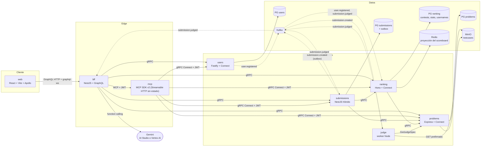
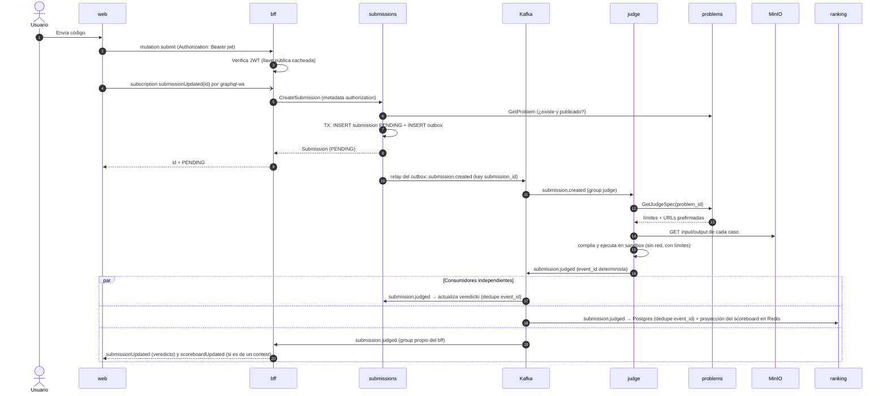
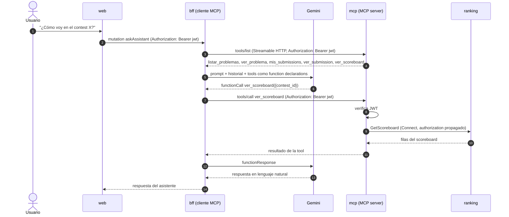

# Arquitectura de juez-online

Juez online de programación competitiva construido como microservicios en TypeScript
(taller de Arquitectura de Software, UCN). Las decisiones están en [`adr/`](adr/).

## Vista general

Líneas sólidas: llamadas síncronas. Punteadas: eventos Kafka (valor en protobuf binario,
key = id del agregado).

## Puertos

| Componente  | HTTP | gRPC  |
| ----------- | ---- | ----- |
| web         | 5173 | —     |
| bff         | 4000 | —     |
| mcp         | 4100 | —     |
| users       | 8081 | 50051 |
| problems    | 8082 | 50052 |
| submissions | 8083 | 50053 |
| ranking     | 8084 | 50054 |
| judge       | 8085 | —     |

Infraestructura: Postgres **55432** en el host (`postgres:5432` dentro de la red de docker;
55432 porque el 5432 suele estar ocupado por un Postgres del sistema), Redis 6379, Kafka 9092 (host; `kafka:29092` dentro de la red
de docker), Kafka UI 8080, MinIO 9000 (API) / 9001 (consola).

## Componentes

| Componente  | Framework                            | Datos             | Ficha                                                     |
| ----------- | ------------------------------------ | ----------------- | --------------------------------------------------------- |
| web         | React + Vite + Apollo Client         | —                 | [apps/web](../apps/web/README.md)                         |
| bff         | NestJS + Apollo GraphQL + graphql-ws | —                 | [apps/bff](../apps/bff/README.md)                         |
| users       | Fastify + ConnectRPC                 | Postgres          | [services/users](../services/users/README.md)             |
| problems    | Express + ConnectRPC                 | Postgres + MinIO  | [services/problems](../services/problems/README.md)       |
| submissions | NestJS híbrido (gRPC + Kafka + HTTP) | Postgres + outbox | [services/submissions](../services/submissions/README.md) |
| ranking     | Hono + ConnectRPC                    | Postgres + Redis  | [services/ranking](../services/ranking/README.md)         |
| judge       | Node sin framework (`node:http`)     | —                 | [services/judge](../services/judge/README.md)             |
| mcp         | MCP TypeScript SDK v2 (sin estado)   | —                 | [services/mcp](../services/mcp/README.md)                 |

**gRPC en servicios no-Nest:** se sirve con `@connectrpc/connect-node` en un servidor
**HTTP/2 separado** del framework web, porque los clientes `@grpc/grpc-js` del BFF y de
submissions requieren HTTP/2. El framework web atiende `/health` y `/metrics`.

**Kafka:** todos usan `kafkajs` (el mismo cliente que usa `@nestjs/microservices`).

**ranking:** Postgres es la fuente de verdad (contests, usernames proyectados desde
`user.registered`, submissions juzgadas y `processed_events`); las estadísticas de usuario se
calculan desde Postgres. Redis guarda **solo una proyección del scoreboard**, recalculada desde
Postgres y reconstruible con `scoreboard:rebuild`; si Redis cae, el scoreboard se calcula desde
Postgres.

**mcp:** usa el MCP TypeScript SDK **v2** (paquetes `@modelcontextprotocol/server` y
`@modelcontextprotocol/node`; `@modelcontextprotocol/client` es el cliente) con Streamable
HTTP en modo **sin estado** (stateless): un `McpServer` nuevo por request, sin sesiones. El
BFF puede usar el cliente v2 (`@modelcontextprotocol/client`) o uno v1.

## Contratos

- Fuente única de gRPC y eventos: [`proto/`](../proto) (buf v2, lint STANDARD, breaking FILE
  contra `main`).
- API del frontend: schema GraphQL **schema-first** en
  [`packages/contracts/graphql/schema.graphql`](../packages/contracts/graphql/schema.graphql),
  exportado como `@juez/contracts/graphql` (`GRAPHQL_SCHEMA_PATH`, la ruta al archivo). El BFF
  lo implementa y el frontend genera sus tipos desde él. Usa el lenguaje del front (enums sin
  `UNSPECIFIED`, fechas `DateTime` ISO 8601, paginación `items` + `nextPageToken`) y documenta
  en cada operación quién puede usarla.
- `@juez/contracts` genera, en su build, `src/gen/es` (protobuf-es v2, para Connect y para
  serializar eventos) y `src/gen/nest` (ts-proto `nestJs=true`, para Nest). El código
  generado no se commitea.
- Paquetes: `juez.common.v1`, `juez.users.v1`, `juez.problems.v1`, `juez.submissions.v1`,
  `juez.ranking.v1`, `juez.events.v1`.

### Autenticación entre servicios

- `users` firma JWT **RS256** (claims `sub`, `username`, `role`, `iss`, `aud`, `iat`, `exp`;
  header `kid`) y expone la llave pública con `UserService.GetPublicKey`.
- El JWT del usuario viaja en la **metadata gRPC `authorization`** con el valor
  `Bearer <jwt>` (constante `AUTH_METADATA_KEY` de `@juez/contracts`):
  - `@grpc/grpc-js` / Nest: `const md = new Metadata(); md.set('authorization', 'Bearer ' + jwt)`.
  - Connect: header `Authorization: Bearer <jwt>` (en HTTP/2 los headers van en minúscula, así
    que es la misma clave).
- bff y mcp verifican el token localmente. Cada servicio que lee el token (`sub`, `role`) lo
  verifica también con la misma llave pública (cacheada al arrancar).
- RPCs sin JWT: `Register`, `Login`, `GetPublicKey` (públicas) y `GetJudgeSpec` (interna del
  judge; se restringe por red).

### Eventos

| Topic                | Mensaje             | Key             | Productor            | Consumidores (group)      |
| -------------------- | ------------------- | --------------- | -------------------- | ------------------------- |
| `user.registered`    | `UserRegistered`    | `user_id`       | users (outbox)       | ranking                   |
| `submission.created` | `SubmissionCreated` | `submission_id` | submissions (outbox) | judge                     |
| `submission.judged`  | `SubmissionJudged`  | `submission_id` | judge                | submissions, ranking, bff |

Cada topic tiene 3 particiones y su DLQ `<topic>.dlq`. `user.registered` es **compactado**
(`cleanup.policy=compact`): como la key es el `user_id`, el log conserva el último evento de
cada usuario indefinidamente y ranking puede reconstruir los usernames leyendo desde el
principio. Los demás topics y todas las DLQ usan la política por defecto (`delete`).
`infra/kafka/create-topics.sh` crea los topics y aplica su configuración con
`kafka-configs --alter` también si ya existían (volúmenes anteriores). Los consumidores son idempotentes por
`event_id`. `encodeEvent(topic, evento)` devuelve `{ key, value, headers, event }` listo para
kafkajs y `decodeEvent(topic, value)` acepta el topic base o su DLQ.

## Flujo de una submission

1. El usuario envía el código; el frontend llama a la mutation `submit` con el JWT.
2. El BFF verifica el JWT localmente y llama a `SubmissionService.CreateSubmission`
   propagando el token en la metadata `authorization`.
3. submissions toma `user_id` del token, valida el problema (y el contest, si viene) y en
   **una transacción** inserta la submission `PENDING` y la fila del outbox con el
   `SubmissionCreated` ya serializado. Responde de inmediato.
4. El relay del outbox publica `submission.created` (key `submission_id`) y marca la fila
   como enviada. Si el proceso cae entre publicar y marcar, el evento se reenvía
   (_at-least-once_).
5. El judge consume el evento, pide `GetJudgeSpec`, descarga los casos con las URLs
   prefirmadas, compila y ejecuta en el sandbox y publica `submission.judged` con un
   `event_id` derivado del `submission_id`, así un reproceso genera el mismo evento.
6. Tres consumer groups independientes reaccionan: **submissions** guarda el veredicto,
   **ranking** guarda la submission en Postgres (estadísticas) y re-proyecta la fila del
   usuario en el scoreboard de Redis, y **bff** empuja `submissionUpdated` al cliente por
   WebSocket (y `scoreboardUpdated` si la submission es de un contest). Todos deduplican por
   `event_id`.
7. Si un consumidor falla de forma persistente, tras N reintentos envía el mensaje a
   `<topic>.dlq` para inspección (Kafka UI en `localhost:8080`).

## Flujo del asistente (MCP)

1. El usuario pregunta en el chat; el frontend llama al BFF con su JWT.
2. El BFF, como **cliente MCP** (transporte Streamable HTTP sin estado: cada request es
   independiente, sin sesión), obtiene la lista de tools del MCP server enviando el JWT del
   usuario en `Authorization`. El MCP valida el header `Host` (`MCP_ALLOWED_HOSTS`): en el
   docker-compose debe incluir `mcp`.
3. El BFF llama a Gemini (Google AI Studio con API key, o Vertex AI; modelo `GEMINI_MODEL`)
   con la conversación y las tools declaradas como funciones.
4. Si Gemini pide una tool, el BFF la ejecuta con `tools/call` en el MCP server.
5. El MCP server verifica el JWT y llama al servicio correspondiente por gRPC (cliente
   Connect) **propagando el mismo token**: el asistente solo ve lo que el usuario puede ver
   (por ejemplo, `mis_submissions` filtra por el `sub` del token).
6. El resultado vuelve a Gemini, que puede pedir más tools o responder; el BFF devuelve la
   respuesta final al frontend.

## Infraestructura local

`pnpm infra:up` levanta `infra/docker-compose.yml` y espera a que todo quede healthy:
Kafka (KRaft, un nodo) + `kafka-init` (topics y DLQ), Kafka UI, PostgreSQL (una instancia;
una BD y un usuario por servicio, sin acceso cruzado), Redis, MinIO + `minio-init`
(bucket privado `testcases`). En Kubernetes cada servicio tiene su propia instancia de BD
([ADR 0005](adr/0005-bd-por-servicio.md)).

El mismo `docker-compose.yml` define los servicios del backend (users, problems, submissions,
ranking, judge con 2 réplicas y mcp) con el profile `apps`, así `pnpm infra:up` sigue
levantando solo la infraestructura:

- `pnpm stack:up` construye las imágenes `juez-<servicio>` y levanta infra + servicios, y
  espera a que todos queden healthy (el healthcheck de cada servicio usa `/ready`).
- Cada servicio con BD aplica sus migraciones al arrancar, en el mismo contenedor
  (`node <migrate> && exec node dist/main.js`), sin contenedores que terminan.
- Dentro de la red se usan los nombres de servicio (`users:50051`, `postgres:5432`,
  `kafka:29092`, `minio:9000`); en el host se publican los puertos de la tabla de arriba
  (salvo el judge, que tiene 2 réplicas). Las llaves JWT se montan desde `.secrets/`.
- El judge corre con un perfil seccomp propio que permite solo `unshare -rn`, para aislar la
  red del sandbox ([infra/judge](../infra/judge/README.md)).
- `pnpm stack:seed` siembra los problemas de ejemplo y `pnpm stack:smoke` recorre el flujo
  completo por gRPC (registro, login, submissions, veredictos, contest y scoreboard).

## Desviaciones por servicio

Durante la fase 1 algunos servicios se apartaron de su ficha original. Cada README tiene el
detalle en su sección "Desviaciones de la ficha"; este es el resumen.

| Servicio                                                                  | Desviaciones                                                                                                                                                                                                                                                                                                                                                                             |
| ------------------------------------------------------------------------- | ---------------------------------------------------------------------------------------------------------------------------------------------------------------------------------------------------------------------------------------------------------------------------------------------------------------------------------------------------------------------------------------- |
| [submissions](../services/submissions/README.md#desviaciones-de-la-ficha) | Consumidor de `submission.judged` con **kafkajs directo** en vez de `Transport.KAFKA` de Nest, para tener commit manual después de persistir, DLQ con el mensaje original y readiness con los eventos del consumidor. gRPC sigue con `Transport.GRPC`.                                                                                                                                   |
| [ranking](../services/ranking/README.md#desviaciones-de-la-ficha)         | **Postgres como fuente de verdad y Redis solo como proyección del scoreboard** (estadísticas, usernames y dedupe en Postgres, en una transacción por evento). `/ready` responde 200 `degraded` si cae Redis. DLQ solo para errores que no se arreglan reintentando. Máximo 26 problemas por contest. `attempts` no cuenta CE ni IE. `GetUserStats` sin `user_id` = el usuario del token. |
| [mcp](../services/mcp/README.md#desviaciones-de-la-ficha)                 | **SDK v2** (`@modelcontextprotocol/server` + `node`) en vez de `@modelcontextprotocol/sdk` (v1), en modo sin estado. `/ready` agregado. Variables opcionales `MCP_*` (en `.env.example`). `ver_submission` consulta además `GetProblem`. Argumentos extra `page_size` y `page_token`.                                                                                                    |

Cambios de la fase 1 que no están en una sección de desviaciones de su README:

- **users** publica `user.registered` con **outbox** (como submissions; el [ADR 0004](adr/0004-outbox-consumidores-idempotentes.md)
  lo recomendaba) y agrega las variables opcionales `USERS_OUTBOX_*` y `USERS_ADMIN_*` (admin
  inicial). Ver [services/users](../services/users/README.md).
- **problems** genera el slug desde el título si no viene y agrega `S3_JUDGE_PRESIGN_TTL_SECONDS`.
  Ver [services/problems](../services/problems/README.md).
- **judge** procesa un mensaje a la vez por instancia e ignora `JUDGE_CONCURRENCY`; el
  aislamiento de red del sandbox depende de `unshare` (limitaciones en Docker). Ver
  [services/judge](../services/judge/README.md) y su [ADR del sandbox](../services/judge/docs/adr-sandbox.md).
